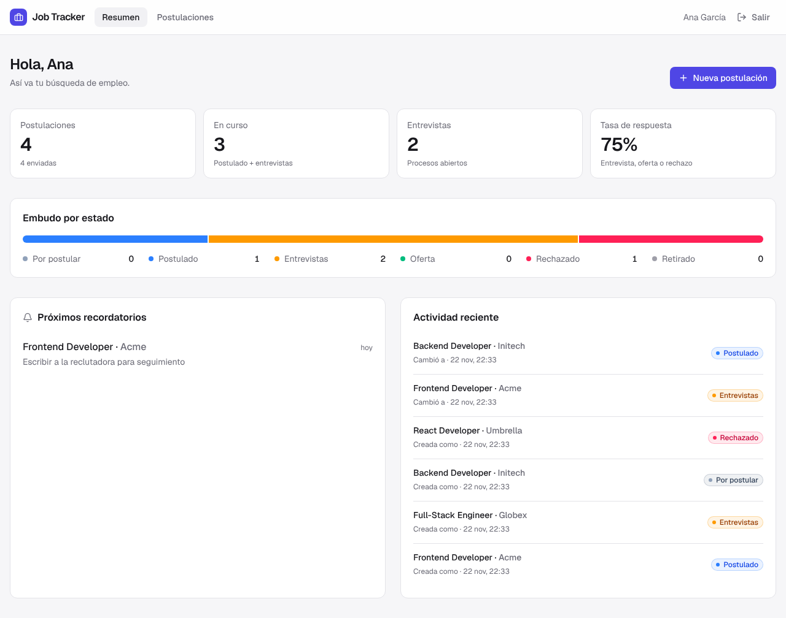
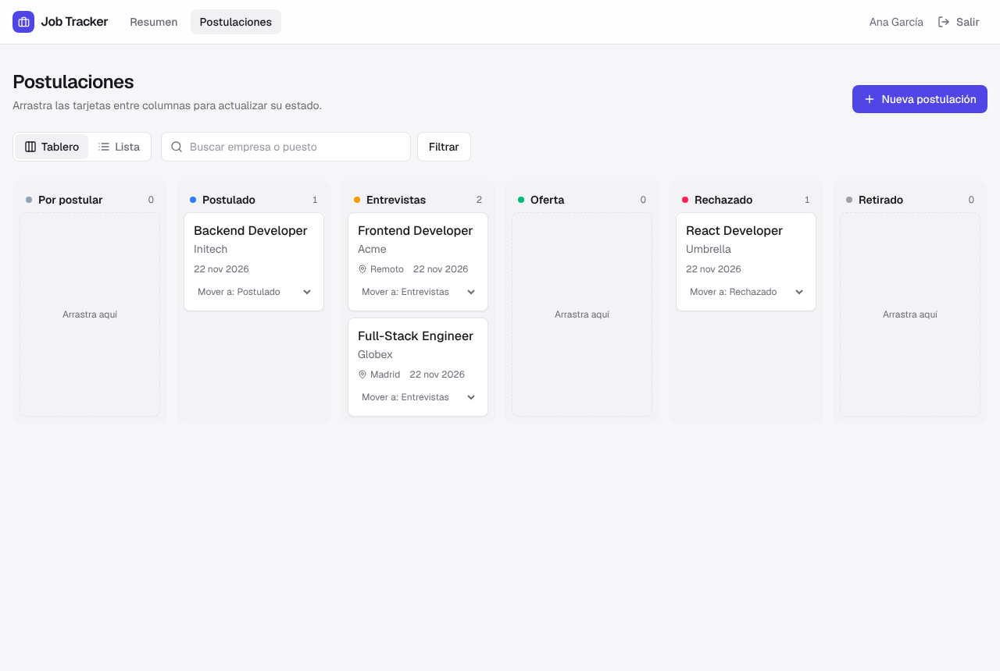
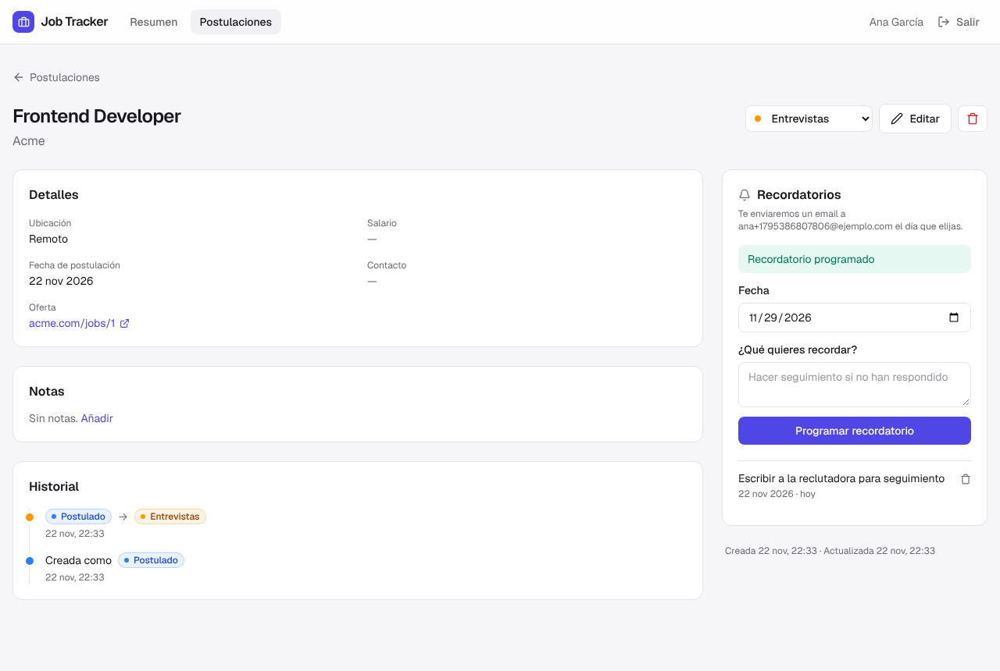
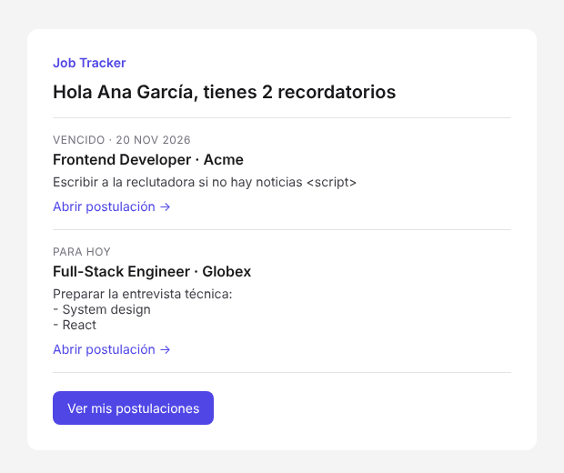

# Job Tracker: rastreador de postulaciones de empleo

Aplicación full-stack para organizar una búsqueda de empleo. Registras cada postulación, sigues su estado en un tablero kanban y programas recordatorios que llegan por email.

**Stack:** Next.js 16 (App Router, Server Actions) · PostgreSQL + Drizzle ORM · Resend · Tailwind CSS 4 · Vercel



## Funcionalidades

- **Autenticación** con email y contraseña: hash con bcrypt y sesiones guardadas en base de datos con cookie `httpOnly`.
- **CRUD de postulaciones**: empresa, puesto, estado, ubicación, salario, enlace, contacto, fecha y notas.
- **Seguimiento de estado** con 6 estados (Por postular, Postulado, Entrevistas, Oferta, Rechazado, Retirado):
  - Tablero kanban con *drag & drop* y actualización optimista. En teclado y móvil hay un selector como alternativa.
  - Historial de cada cambio de estado con su fecha.
- **Recordatorios por email** (Resend): eliges un día y un mensaje. Un cron diario envía **un solo correo por usuario** con todos sus recordatorios pendientes.
- **Resumen**: métricas (en curso, entrevistas, tasa de respuesta), embudo por estado, próximos recordatorios y actividad reciente.
- Vista de lista con búsqueda y filtro por estado. Diseño responsive y modo oscuro automático.

| Tablero | Ficha | Email |
| --- | --- | --- |
|  |  |  |

## Arquitectura

```
src/
├── actions/            Server Actions (auth, postulaciones, recordatorios)
├── app/
│   ├── (auth)/         /login y /register
│   ├── (app)/          Área privada: /dashboard, /applications, /applications/[id], …/edit
│   └── api/cron/reminders/route.ts   Endpoint que invoca Vercel Cron
├── components/         UI (tablero, formularios, insignias…)
├── lib/
│   ├── auth/           Sesiones y contraseñas
│   ├── db/             Esquema de Drizzle y cliente de PostgreSQL
│   ├── dal.ts          Capa de acceso: getCurrentUser / requireUser
│   ├── queries.ts      Lecturas, siempre filtradas por el usuario de la sesión
│   ├── reminders.ts    Envío de recordatorios pendientes
│   └── validation.ts   Esquemas de Zod
└── proxy.ts            Redirección optimista a /login (antes "middleware")
drizzle/                Migraciones SQL
vercel.json             Programación del cron
```

**Modelo de datos:** `users` → `applications` → `status_changes` (historial) y `reminders`. Además está `sessions`. Todas las claves foráneas usan `ON DELETE CASCADE`.

**Decisiones de diseño:**

- **Seguridad:** cada Server Action vuelve a validar la sesión y filtra por `user_id`. El cliente nunca decide de quién son los datos. Una postulación de otro usuario devuelve 404.
- **Sesiones:** en la cookie va un token aleatorio de 256 bits. En la base de datos solo se guarda su SHA-256, así que una filtración de la tabla no permite suplantar a nadie. La sesión dura 30 días y se renueva con el uso.
- **Login:** el mensaje de error es el mismo exista o no el email, y siempre se compara un hash para que el tiempo de respuesta no revele qué cuentas existen.
- **Recordatorios sin duplicados:** antes de enviar, cada lote se reclama de forma atómica (`UPDATE … WHERE sent_at IS NULL RETURNING`). Dos ejecuciones simultáneas del cron no envían el mismo correo. Si Resend falla, el lote se libera y se reintenta en la siguiente ejecución. También se envía un `idempotencyKey` a Resend.
- **Fechas:** las fechas de calendario se guardan como `date`, sin zona horaria. "Hoy" se calcula con `APP_TIMEZONE`, igual en la web y en el cron.

## Desarrollo local

Requisitos: Node.js 22+ y PostgreSQL 14+ (o Docker).

```bash
npm install
cp .env.example .env        # ajusta DATABASE_URL
```

Si no tienes PostgreSQL instalado, puedes levantarlo con Docker:

```bash
docker run -d --name jobtracker-db -p 5432:5432 -e POSTGRES_USER=jobtracker -e POSTGRES_PASSWORD=jobtracker -e POSTGRES_DB=jobtracker postgres:16
```

```bash
npm run db:migrate
npm run dev
```

Abre http://localhost:3000. Sin `RESEND_API_KEY`, en desarrollo los correos se imprimen en la consola. Para lanzar el envío de recordatorios a mano:

```bash
curl -H "Authorization: Bearer $CRON_SECRET" http://localhost:3000/api/cron/reminders
```

### Scripts

| Script | Descripción |
| --- | --- |
| `npm run dev` | Servidor de desarrollo |
| `npm run build` / `npm start` | Build y servidor de producción |
| `npm run lint` / `npm run typecheck` | ESLint y TypeScript |
| `npm run db:generate` | Genera una migración a partir de `src/lib/db/schema.ts` |
| `npm run db:migrate` | Aplica las migraciones pendientes |
| `npm run db:studio` | Explorador visual de la base de datos |

## Despliegue (Vercel + Neon + Resend)

1. **Base de datos.** Crea un proyecto en [Neon](https://neon.tech) (o añade la integración de Neon desde el Marketplace de Vercel) y copia la cadena de conexión *pooled*.
2. **Resend.** Crea una API key en [resend.com](https://resend.com/api-keys). Para enviar a cualquier destinatario, verifica un dominio y usa un remitente de ese dominio en `EMAIL_FROM`. Sin dominio verificado, `onboarding@resend.dev` solo entrega al email de tu propia cuenta de Resend.
3. **Vercel.** Sube el repositorio a GitHub e impórtalo en [vercel.com/new](https://vercel.com/new). Añade estas variables de entorno:

   | Variable | Valor |
   | --- | --- |
   | `DATABASE_URL` | Cadena de conexión de Neon |
   | `RESEND_API_KEY` | API key de Resend |
   | `EMAIL_FROM` | `Job Tracker <recordatorios@tudominio.com>` |
   | `CRON_SECRET` | Un secreto aleatorio (`openssl rand -hex 32`) |
   | `APP_URL` | URL pública, p. ej. `https://job-tracker.vercel.app` |
   | `APP_TIMEZONE` | Zona horaria IANA, p. ej. `Europe/Madrid` o `America/Mexico_City` |

4. **Deploy.** Vercel ejecuta `vercel-build`, que aplica las migraciones (`drizzle-kit migrate`) antes de `next build`. El cron de `vercel.json` llama a `/api/cron/reminders` cada día a las 14:00 UTC, y Vercel envía `CRON_SECRET` automáticamente en la cabecera `Authorization`.

> En el plan Hobby, Vercel permite crons diarios, así que los recordatorios funcionan por día, no por hora. Con el plan Pro puedes aumentar la frecuencia en `vercel.json` sin cambiar código.

## Posibles mejoras

- Recuperación de contraseña y verificación de email (también con Resend).
- Límite de intentos en el login.
- Tests end-to-end con Playwright en CI.
- Importar ofertas desde una URL o exportar a CSV.
